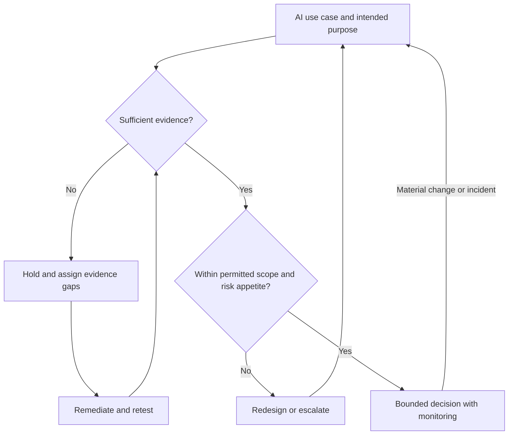

# Applied AI Governance

### Decisions, accountability, and control evidence for financial services

**Juan A. Martinez Diaz, MBA** · Former Wells Fargo Vice President · Founder, Bounded Agentic Intelligence

This portfolio follows a fictional financial institution from discovering AI use to assessing risk, assigning decision authority, responding to an incident, and deciding whether evidence supports a release. It connects governance documentation to decisions and reproducible checks.

[Employer brief](EMPLOYER-BRIEF.md) · [Download the one-page PDF](output/pdf/Juan_Martinez_AI_Governance_Brief.pdf) · [Contact Juan](mailto:juan@boundedagenticai.com) · [LinkedIn](https://www.linkedin.com/in/juan-martinez-diaz-50943411)

**Evidence scope:** original, AI-assisted synthetic case studies and bounded executable demonstrations. [Authorship and review status](AUTHORSHIP.md) · [Verification and limitations](VERIFICATION.md)

## A five-minute review

| Start here | Decision or capability to inspect |
| --- | --- |
| **[1. Read the executive decision](project-02-risk-assessment/governance-review-memo.md)** | Why live candidate ranking remains on hold, what evidence is missing, and which alternative deserves evaluation. |
| **[2. Follow a finding through remediation and retest](evidence/control-lifecycle.md)** | What a small executable output contract accepts, rejects, and invalidates when the permitted scope changes. |
| **[3. Examine who has authority](project-03-responsible-ai-policy/governance-operating-model.md)** | Who owns risk, who independently challenges it, and who can decide or escalate. |
| **[4. Compare time, effort, and cost](business-case/README.md)** | How explicitly assumed operating conditions change the business case. |

## Five connected projects

| Project | Business question | Inspectable work |
| --- | --- | --- |
| [01 · Inventory and classification](project-01-ai-system-inventory/README.md) | Which AI uses require enhanced review or further facts? | Ten-system register, purpose-based triage, reconciliation, and NIST gap mapping. |
| [02 · Risk assessment](project-02-risk-assessment/README.md) | Should a recruitment ranking system proceed? | Scored risks, synthetic disparity analysis, control acceptance criteria, and an executive hold decision. |
| [03 · Policy and operating model](project-03-responsible-ai-policy/README.md) | Who owns, challenges, approves, and escalates? | Lifecycle gates, separation of duties, and a worked exception decision. |
| [04 · Incident response](project-04-incident-response/README.md) | How should a harmful credit-model signal be handled? | Containment timeline, evidence discipline, reporting decisions, and competing root-cause hypotheses. |
| [05 · High-risk documentation](project-05-high-risk-documentation/README.md) | Is a replacement hiring system ready? | Six documentation modules, supplier evidence review, gaps, and a blocked release decision. |

## How evidence changes a decision



The diagram describes the governance approach. The runnable demonstration implements a deliberately narrower synthetic output-contract lifecycle. It does not approve CandidateRank, validate a vendor model, or authorize a real deployment.

## Inspect the evidence

- [Control lifecycle demonstration](evidence/control-lifecycle.md): baseline weakness, remediation, rejected outputs, and scope-change invalidation.
- [Traceability](TRACEABILITY.md): risk, control, test, evidence, owner, and decision.
- [Management scorecard](MANAGEMENT-SCORECARD.md): metric definitions, thresholds, evidence status, and decisions requested.
- [U.S. financial-services application](US-FINANCIAL-SERVICES.md): connection to RCSA, model risk, technology risk, third-party risk, and issue management.
- [Business case](business-case/README.md): reproducible assumptions and sensitivity analysis; no achieved savings claimed.

## Reproduce the checks

Python 3.10 or newer; standard library only for the governance checks. No credentials, paid services, real personal data, model training, or external API calls are required.

```bash
python3 -m unittest discover -s tests -v
python3 tools/evaluate.py
python3 tools/verify_evidence.py
```

[Automated verification](https://github.com/JuanAMartinezDiaz/ai-governance-portfolio/actions/workflows/portfolio-evidence.yml) runs the evidence checks on repository changes. The [verification record](VERIFICATION.md) explains what passed and what remains outside the demonstration.

## Scenario, provenance, and related work

HarborBridge Financial Services and its people, vendors, transactions, incidents, and decisions are fictional. The original EU case studies assume a proposed 2028 deployment and use the dated legal baseline in [SOURCES.md](SOURCES.md); applicability must be reassessed for a real organization.

The five-project learning structure was inspired by [Taimur Ijlal / The Cloud Security Guy's AIGovernance repository](https://github.com/taimurijlal/AIGovernance), reviewed at revision `d5eb5a497f43135e6410e0c6384896fd23524af4`. This portfolio supplies original scenarios, records, analysis, and executable examples. No completed source artifacts were copied. The initial November 10 edition remains in the [profile repository history](https://github.com/JuanAMartinezDiaz/JuanAMartinezDiaz/tree/7e7e6e56bf544578643d8927cfb3c757d4b247de/ai-governance-portfolio).

[Sentinel](https://github.com/JuanAMartinezDiaz/sentinel-governed-workflow-twin) is a separate public reference implementation for AI-agent authority controls. Its tests do not validate this portfolio, and this portfolio does not establish Sentinel's production readiness.

[Interview walkthrough](INTERVIEW.md) · [Professional profile](https://github.com/JuanAMartinezDiaz) · [juanmartinez.ai](https://www.juanmartinez.ai)
